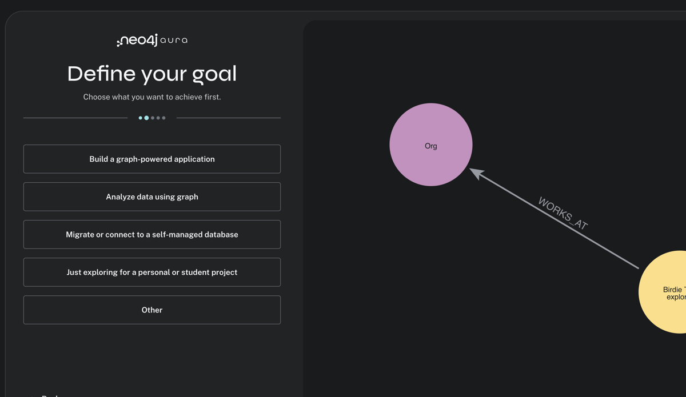
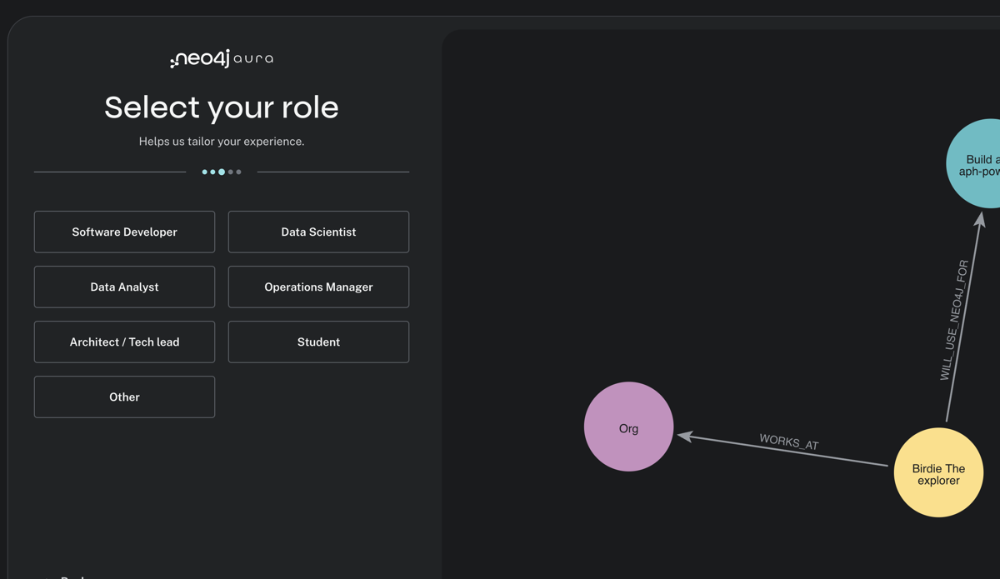
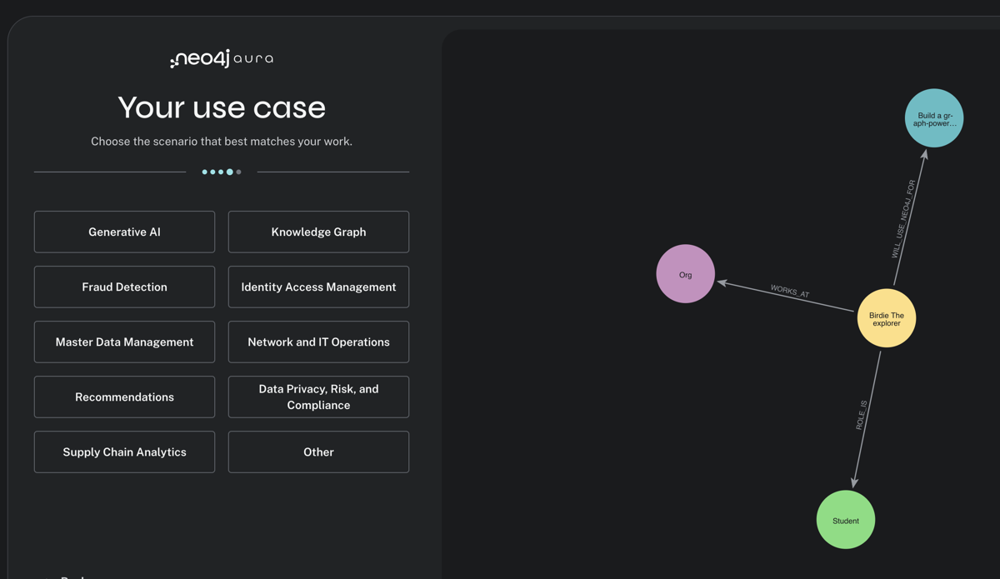

# Jarvis

**A personal assistant inside Gemini that remembers your life and helps you follow through.**

Tell it things the way you'd tell a friend: *"I have to pay rent by Friday"*, *"gym every weekday at 6"*, *"I want to eat healthier"*. Jarvis remembers, plans a first step ahead of time, puts it on your calendar, checks in, and backs off when you say stop. Your memories live in **your own free database**, not in a chat history.

---

## Set it up — about 10 minutes, all free

### 1. Get your free database (3 min)
1. Go to **[console.neo4j.io](https://console.neo4j.io)** and sign in with Google.
2. Aura asks a few quick questions. Answer them like this (these are the answers we tested with):
   | Screen | Pick |
   |---|---|
   | **Define your goal** — *Choose what you want to achieve first.* | **Build a graph-powered application** |
   | **Select your role** — *Helps us tailor your experience.* | **Student** (or whatever fits you) |
   | **Your use case** — *Choose the scenario that best matches your work.* | **Knowledge Graph** |
   <details><summary>Show me the screens</summary>

   
   
   
   </details>
3. Click **Create instance** → **Free** → wait until it says *Running*.
4. Copy the **Instance ID** (8 characters, like `1a2b3c4d`) shown on the instance card.

### 2. Connect it to Gemini (2 min)
1. In [Gemini](https://gemini.google.com): **More** → **Customize** → **Connectors** → **+ Custom**.
2. URL: `https://YOUR-INSTANCE-ID.mcp-instances.neo4j.io` (paste your ID in place of `YOUR-INSTANCE-ID`).
3. Leave client ID and secret **empty** → sign in with **Continue with Neo4j Aura**.
4. Name it **`Jarvis Memory`**.

### 3. Add the Jarvis skill (3 min)
1. **More** → **Customize** → **Skills** → **Create** → **Create manually**.
2. **Name:** `jarvis`
3. **Description:** copy this —
   ```
   Your Jarvis, backed by the Jarvis Memory connector. Use whenever the user tells you something about their life, asks what you know or remember, asks what you can do, mentions routines, reminders, plans, habits or things they want to be true, or types a command starting with 'jarvis'.
   ```
4. **Instructions:** open **[this file](https://raw.githubusercontent.com/kbhatiya999/jarvis-memory/main/skills/gemini/INSTRUCTIONS.txt)**, select all, copy, paste.
5. Click **Save**.

### 4. Say hello (2 min)
1. Start a new chat and switch **Chat → Task** (just under the message box).
2. Type `@jar`, pick **jarvis**, and send: **`jarvis setup`**
3. Click **Allow once** when asked, and answer four quick questions (your name, pronouns, time zone, language).

Done. From now on just start a Task message with `@jarvis`.

---

## What to say

| You say | Jarvis does |
|---|---|
| "I have to pay the electricity bill by Wednesday 8pm" | Plans a step the evening before, adds it to your calendar, reminds you |
| "Gym every weekday at 6pm" | Sets up the routine and helps *today's* session happen |
| "I want to be healthier" | Remembers it and suggests small steps when you have free time |
| "Done" / "Skipped it" | Records only what you confirm, and learns from it |
| "Stop reminding me about the gym" | Stops for good |
| `jarvis today` · `jarvis brief` · `jarvis beliefs` · `jarvis why` · `jarvis help` | Today's list · a quick brief · what it believes about you · why it did something · all commands |

---

## Troubleshooting

| Problem | Fix |
|---|---|
| **"I can't reach your memory"**, or the connector fails to sign in | In [console.neo4j.io](https://console.neo4j.io): **Organization → Security** → turn on **Tool authentication with Aura user** and tick your instance. Then reconnect the connector in Gemini. |
| Jarvis doesn't respond as Jarvis, or acts like a generic bot | Use **Task**, not Chat. Start the message with `@jarvis` picked from the list. |
| "I don't have access" / tools never run | Switch the model to **Hydrogen** (Everyday help). In our tests the Deeper analysis model could not use connectors. |
| The skill's instructions went back to the old text after saving | Save again and wait until the button says **Saved**, then reopen **⋯ → Edit manually** to check it starts with `GEMINI COPY OF JARVIS`. |
| It asks permission before every save | That's Gemini's safety setting. Click **Allow once**, or set the connector's Read/Write to *Always allow* in Gemini's connector settings. |
| Jarvis says a newer version is live | Open the skill → **⋯ → Edit manually** → replace the instructions with the latest [file](https://raw.githubusercontent.com/kbhatiya999/jarvis-memory/main/skills/gemini/INSTRUCTIONS.txt) → Save. Your memories are untouched. |
| Setup stopped with an error | Send `jarvis setup` again — every step is safe to repeat. |

---

## Using Claude instead
Add the same connector in claude.ai (**Settings → Connectors → Add custom connector**, same URL), create a skill from [`skills/claude/SKILL.md`](skills/claude/SKILL.md), and say `jarvis setup`. Claude and Gemini can share one database.

<details>
<summary><b>How it works, privacy, and updates</b></summary>

- **Your data stays yours.** Everything Jarvis remembers is stored in your own Neo4j database. This repo contains only instructions — nothing personal.
- **Versioned and upgradeable.** Your database holds the active Jarvis version. `jarvis upgrade` fetches the latest [`release.json`](release.json), checks its fingerprint (md5), applies only the changes you haven't had, and verifies nothing was lost. `jarvis version` shows what's live; `jarvis rollback` goes back.
- **Gemini** keeps its own copy of the instructions (Gemini doesn't allow skills that load instructions from a database), so after an upgrade it tells you to re-paste the file.
- **What Jarvis must always do (the Charter):** plan backward from deadlines; help today's attempt while it can still succeed; offer help on its own when it notices room; say why it suggests anything; treat "stop" as permanent; learn from outcomes; show and delete anything it believes about you on request; never claim something happened unless you said so.

**Files:** `release.json` (latest release) · `releases/vN.json` (frozen versions) · `instructions.txt` + `build.py` (source and build) · `skills/gemini/INSTRUCTIONS.txt` · `skills/claude/SKILL.md`
</details>
